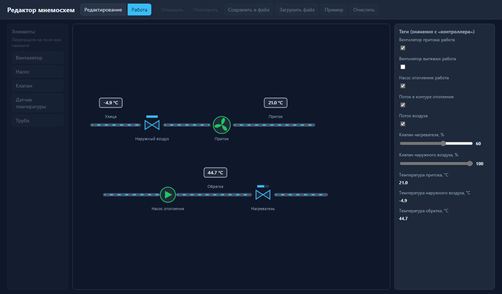

# Редактор мнемосхем

Конструктор мнемосхем в браузере: элементы (вентилятор, насос, клапан, датчик, труба)
перетаскиваются на поле и привязываются к тегам. В режиме «Работа» схема оживает:
вентиляторы вращаются, по трубам идёт поток, клапаны показывают положение, датчики значения.
Продолжение проектов [office-dashboard](https://github.com/lynxy-coder/office-dashboard)
и [event-journal](https://github.com/lynxy-coder/event-journal). Без фреймворков: HTML, SVG, CSS и JavaScript.



## Что умеет

- перетаскивание элементов из палитры на поле, перемещение, привязка к сетке 10 единиц
- труба двигается целиком, а её концы тянутся за маркеры
- свойства выбранного элемента: подпись и тег
- отмена и повтор действий (Ctrl+Z, Ctrl+Y), удаление клавишей Delete
- сохранение схемы в JSON-файл и загрузка из файла, автосохранение в браузере
- режим «Работа»: анимация по значениям тегов, клик по элементу переключает его тег
- готовая схема-пример: приточная установка и контур отопления

Значения тегов в режиме работы имитируются в браузере (температуры «гуляют», остальные
меняются вручную в правой панели). Ссылка с `#run` открывает схему сразу в режиме работы.

## Запуск

Сервер не нужен, достаточно открыть `public/index.html` через любой статический сервер.
С Node.js:

```bash
npm start
```

Открыть http://localhost:3000. Тесты: `npm test`.
